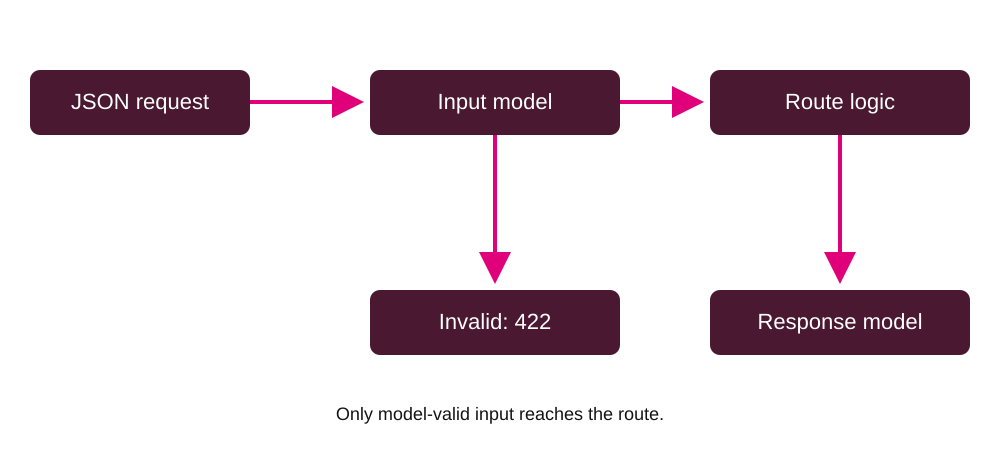

# Lab - Data validation and API error handling

Create a small API yourself, strengthen its input contract, and make failures predictable. Work individually; compare predictions with a partner, but write and explain your own code. Allow 30, 25, 35 and 25 minutes for exercises 1–4. Homework takes about 60 minutes.

## Start here

You need Python 3.12, a terminal, an editor and a browser. These exercises use Pydantic v2. You should recognise Python classes/type hints, dictionaries, function decorators, JSON and HTTP requests. A type hint describes an expected type; Pydantic uses it at runtime to parse and validate data. A FastAPI route decorator connects an HTTP method/path to a function.

Create your own empty working directory outside this resource folder. No starter application is provided for exercises 1 or 2. Keep the `solutions/` directories closed until you have attempted the corresponding task. Each is a possible solution with runnable verification tests, not a required implementation.

### Environment

From your empty working directory:

```bash
python -m venv .venv
```

Activate it on Windows PowerShell with `.venv\Scripts\Activate.ps1`; on macOS/Linux use `source .venv/bin/activate`. If activation is blocked, use `.venv\Scripts\python.exe` (Windows) or `.venv/bin/python` (macOS/Linux) wherever these instructions say `python`.

Copy only the resource root `requirements.txt` into your directory, then run:

```bash
python -m pip install -r requirements.txt
python -c "import fastapi, pydantic; print(fastapi.__version__, pydantic.__version__)"
```

Expected versions: FastAPI 0.162.0 and Pydantic 2.14.2. The tested environment is Python 3.12. These are the pack's tested pins, not a promise about the versions installed in college labs.

### GitHub Codespaces (alternative)

You can use a Codespace instead of setting up Python on your computer. From this repository's GitHub page, choose **Code** → **Codespaces** → **Create codespace on ...** and wait for the environment to finish setting up. Open a terminal at the repository root, then create a separate working directory and install the pack's dependencies into the Codespace's Python:

```bash
mkdir -p ~/api-validation-practice
cp requirements.txt ~/api-validation-practice/
cd ~/api-validation-practice
python -m pip install -r requirements.txt
python -c "import fastapi, pydantic; print(fastapi.__version__, pydantic.__version__)"
```

No virtual environment or activation is needed in this Codespace. The packages are installed in its shared Python environment; this does not change your computer's Python installation. Keep your exercise files in `~/api-validation-practice`, outside the resource folder.

## The request boundary



JSON is checked by the input model before route logic runs. Invalid data returns 422. A successful normal return is checked and filtered by the response model. This application does not store records.

## Learning route

1. [Exercise 1: build from an empty project](exercise-01/README.md).
2. [Exercise 2: constrain and validate](exercise-02/README.md).
3. [Exercise 3: predictable errors](exercise-03/README.md).
4. [Exercise 4: focused tests](exercise-04/README.md).
5. [Homework: movie guessing game](homework/README.md).

Continue using your own `main.py` for exercises 1–4. The endpoint checks requests without saving data or reserving equipment. Do not add SQLAlchemy, CRUD, a database, authentication or cloud services.

## Running and recovery

Run `python -m uvicorn main:app --reload` from the directory containing your `main.py`. Open http://127.0.0.1:8000/docs. Stop with Ctrl+C. After changing code, check the terminal for reload errors before retrying. If port 8000 is occupied, stop your earlier server or use `--port 8001` and the matching browser address.

In Codespaces, run the server from your working directory and open port 8000 from the **Ports** tab; use its forwarded address followed by `/docs`.

Run tests in a second terminal using the same environment: `python -m pytest -q`. A running Uvicorn server is not required for TestClient tests. Keep a saved copy or Git commit after each exercise. To recover, return to your previous working copy and reapply one change at a time.

| Symptom | Check |
|---|---|
| Cannot import main | Current directory, file name and saved file |
| No module named fastapi | Interpreter/environment and requirements install |
| Swagger shows old fields | Reload error, browser refresh, correct server port |
| `str | None` still required | Add a default if omission should be allowed |
| Whitespace-only string accepted | Strip whitespace before length validation |
| 422 where you expected 409 | Schema validation happens before route logic |
| Test discovery imports wrong main | Run each solution directory separately |

Minimum catch-up: finish exercise 1, implement quantity and blank-name constraints in exercise 2, add one 409 failure in exercise 3, and test one accepted boundary plus one rejected boundary in exercise 4. Then finish the remaining core checks before progressing.

## Dependency note

The tested Starlette version emits a deprecation warning for HTTPX-based TestClient use. Tests still run successfully with these pins. Treat a warning separately from a failing assertion; do not change dependencies mid-exercise. The tutor can review a future migration separately.
